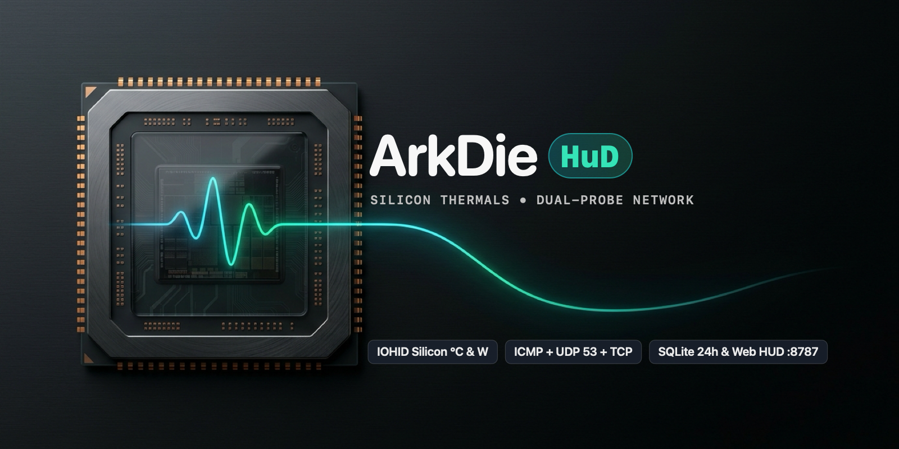
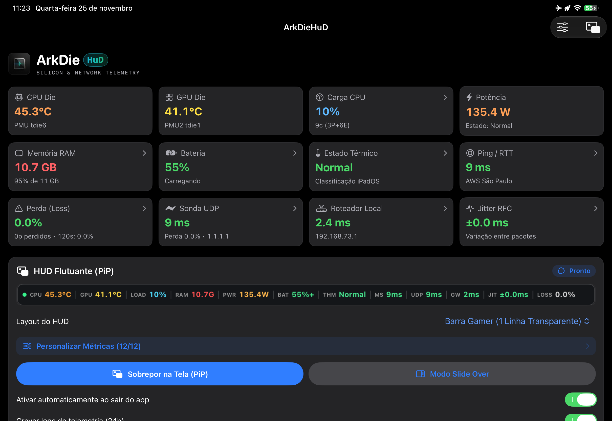
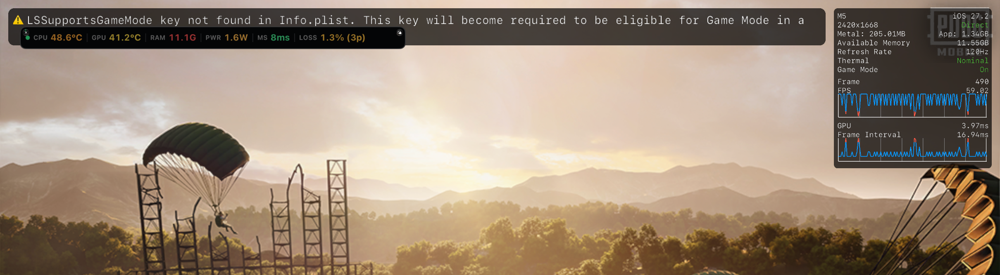
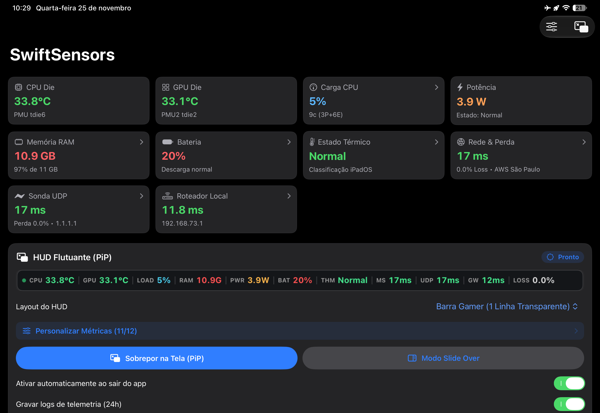
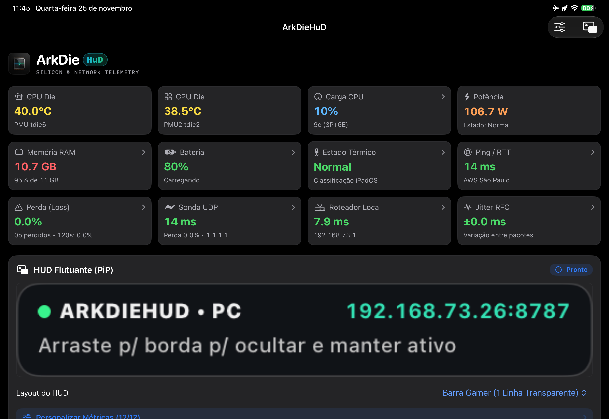

<p align="center">
  
</p>

<p align="center">
  <a href="README.md">English</a> | <a href="README.pt-BR.md">Português (BR)</a> | <strong>Español</strong>
</p>

# ArkDieHuD

[](https://swift.org/platforms/)
[](https://swift.org)
[](docs/TUTORIAL.es.md)
[](LICENSE)

**ArkDieHuD** es una suite de telemetría física en tiempo real para **Apple Silicon (iPadOS e iOS)** construida sobre el motor `SwiftSensors` (`IOHID` + kernel `Mach`), con HUD flotante Picture-in-Picture (`PiP`), panel **Slide Over**, Sonda Doble Multiprotocolo (**`ICMP + UDP DNS 53 + TCP`**), historial continuo de **24h en SQLite WAL** y panel web local (**`:8787`**) para monitorear desde tu PC o Mac **sin tapar la pantalla del juego**.

> **¿Primera vez?** Consulta el **[Tutorial Paso a Paso (ES)](docs/TUTORIAL.es.md)** · **[Tutorial (PT-BR)](docs/TUTORIAL.pt-BR.md)** · **[Tutorial (EN)](docs/TUTORIAL.md)**

---

## Características Principales

- **Sensores Físicos Reales (`IOHID` + `Mach`):** temperatura directa del die de CPU (`PMU tdie`) y GPU (`PMU2 tdie`), rieles de voltaje/corriente, potencia (`W`), carga de CPU, RAM + margen Jetsam y estado térmico de iPadOS — cero valores inventados.
- **HUD Flotante PiP + Personalización Total:** 4 diseños dinámicos (*Barra Gamer*, *Overlay Gamer*, *Cuadrícula Compacta*, *Detallado*) y **12 interruptores independientes** con 4 perfiles de un toque, además de modo **Slide Over**.
- **Red Competitiva (Sonda Doble y Multiprotocolo):** ping nativo `SOCK_DGRAM` **ICMP**, sonda real **UDP (DNS 53)** y **TCP** en paralelo contra el **Router Local (Gateway)** para distinguir caídas de Wi-Fi frente a caídas del proveedor/CGNAT, con `P50/P95/P99`, Jitter RFC 3550 y registro de incidentes de 1 hora.
- **Historial Persistente 24h (SQLite WAL):** escritura por lotes cada 15s con limpieza automática > 24h, gráficos agregados (`15m | 1h | 6h | 24h`) y exportación CSV unificada.
- **Monitor en PC/Mac Sin PiP en Pantalla (`:8787`):** panel web offline servido directo desde el iPad por Wi-Fi o cable USB (`iproxy 8787 8787`), con modo **PiP Discreto** (*Arrastra al borde p/ ocultar y seguir activo*) para juegos con micrófono de voz.
- **Soporte Automático en 3 Idiomas (`es` / `pt-BR` / `en`):** detección automática según el idioma de iPadOS en la app, PiP y permisos, más detección automática y selector manual (`EN | PT | ES`) en el panel web del PC.
- **Listo para Apple ID Gratuito:** entitlements limpios y generador de `.ipa` sin firma (`./Scripts/export-ipa.sh`).

---

## Capturas Reales en iPad

<table>
  <tr>
    <td width="50%">
      
      <p align="center"><em>Panel Principal + Franja en Vivo y Vista Previa PiP</em></p>
    </td>
    <td width="50%">
      
      <p align="center"><em>Barra Gamer PiP + Apple Metal FPS HUD sobre PUBG</em></p>
    </td>
  </tr>
  <tr>
    <td width="50%">
      
      <p align="center"><em>Gráficos Persistentes 24h (SQLite WAL) y Exportación CSV</em></p>
    </td>
    <td width="50%">
      
      <p align="center"><em>Píldora Discreta para Monitor PC (:8787) — Arrastra al borde</em></p>
    </td>
  </tr>
</table>

---

## Cómo Instalar — Elige el Mejor Método Para Ti

| Método | ¿Para quién es? | ¿Requiere Mac / Xcode? | Cómo funciona |
| :--- | :--- | :--- | :--- |
| **1. Sideloadly + `.ipa`** *(Recomendado)* | **Más fácil y sencillo** (Windows o Mac, sin terminal) | **No** | Descarga [`ArkDieHuD-unsigned.ipa`](https://github.com/Despensativo/ArkDieHuD/releases/latest/download/ArkDieHuD-unsigned.ipa) y arrástralo en [Sideloadly](https://sideloadly.io/) con cualquier **Apple ID gratuito**. |
| **2. SideStore / AltStore Classic** | **Actualizaciones y renovación automáticas** | **No** *(tras configurar)* | Añade la fuente oficial en SideStore/AltStore Classic y pulsa **GET**. |
| **3. Asistente en Mac** | **Usuarios de Mac con Xcode** | **Sí** | Ejecuta `./install.sh` — detecta iPad y Apple ID automáticamente, compila e instala. |

### Opción 1 — Más Fácil y Sencillo — Recomendado (Windows o Mac, Sin Xcode)
1. Descarga [`ArkDieHuD-unsigned.ipa`](https://github.com/Despensativo/ArkDieHuD/releases/latest/download/ArkDieHuD-unsigned.ipa).
2. Abre **Sideloadly**, conecta tu iPad, introduce tu **Apple ID gratuito** e instala el `.ipa`.
3. En el iPad: activa **Ajustes → Privacidad y Seguridad → Modo de Desarrollador** y toca **Confiar** en **Ajustes → General → Gestión de VPN y Dispositivos**.

### Opción 2 — Fuente Oficial SideStore / AltStore Classic
Pega esta URL en **SideStore** o **AltStore Classic** (*Sources → +*):
```text
https://raw.githubusercontent.com/Despensativo/ArkDieHuD/main/altstore-source.json
```

> **Importante (UE, Japón y Brasil):** En [altstore.io](https://altstore.io/), usa **AltStore Classic** (vía AltServer) o **SideStore** — **no AltStore PAL**. AltStore PAL solo instala paquetes notarizados por Apple (ADP) y no admite archivos `.ipa` sin firmar ni APIs privadas (`IOHID` de temperatura del silicio ni controles internos de PiP).

### Opción 3 — Asistente Guiado en Mac (`./install.sh`) y Extras
```bash
# 1) Clonar y ejecutar el instalador guiado (detecta iPad y cuenta Apple gratuita o de pago)
git clone https://github.com/Despensativo/ArkDieHuD.git
cd ArkDieHuD
./install.sh

# 2) Opcional: Generar el .ipa sin firma localmente
./Scripts/export-ipa.sh

# 3) Opcional: Abrir CUALQUIER juego o app en tu iPad con Apple Metal FPS HUD
./launch_metal_hud.sh                         # Menú interactivo (todas las apps instaladas)
./launch_metal_hud.sh <nombre_app>            # Buscar por nombre (ej: genshin, cod, pubg, capcut)
./launch_metal_hud.sh --list                  # Listar todas las apps y sus Bundle IDs
./launch_metal_hud.sh --bundle <bundle.id>    # Iniciar directamente por Bundle ID
# Consejo: añade atajos en `CUSTOM_SHORTCUTS` dentro de `launch_metal_hud.sh` (o pídeselo a tu IA).

# 4) Opcional: Túnel USB para abrir el panel PC en http://127.0.0.1:8787
iproxy 8787 8787
```

> **Apple ID Gratuito vs Cuenta de Pago y Por Qué No Viene Prefirmado:**
> - Una **cuenta gratuita de Apple** funciona al 100% (dura **7 días**; en SideStore/AltStore Classic se renueva sola, o vuelve a ejecutar `./install.sh` / Sideloadly). Una cuenta de pago dura **1 año**.
> - Los sensores reales de silicio y potencia usan APIs privadas (`IOHID`), no permitidas en la App Store y que requieren firma personal.

---

## ☕ Apoya el Desarrollo

Si **ArkDieHuD** te ahorró tiempo o te ayudó a diagnosticar el hardware y las caídas de red en tu iPad, considera apoyar el desarrollo. ¡Cualquier contribución impulsa nuevas investigaciones en Apple Silicon y herramientas de código abierto!

<p align="left">
  <a href="https://www.buymeacoffee.com/despensativo" target="_blank">
    
  </a>
</p>

<details>
  <summary>🇧🇷 <b>Apoyar vía Pix (Brasil) — Código QR y Copiar/Pegar</b></summary>
  <br>

  <p align="left">
    
  </p>

  **Pix Copia e Cola:**
```text
00020101021126580014br.gov.bcb.pix01368e4ae808-3a54-4b91-bd4a-0e4249cd37875204000053039865802BR5917HEDSON C DA SILVA6013APARECIDA DE 62070503***6304BE1E
```

  > **Titular:** Hedson C da Silva  
  > **Clave Aleatoria / Chave Aleatória:** `8e4ae808-3a54-4b91-bd4a-0e4249cd3787`

</details>

---

## Nota sobre APIs Privadas y Créditos

- Este proyecto utiliza APIs privadas `IOKit` / `IOHID` para acceder a sensores internos del hardware. Está pensado para diagnóstico local, benchmarks y compilación personal en Modo Desarrollador (no para App Store).
- Basado originalmente en [`trymirai/swift-sensors`](https://github.com/trymirai/swift-sensors) bajo licencia MIT. Consulta [LICENSE](LICENSE).
