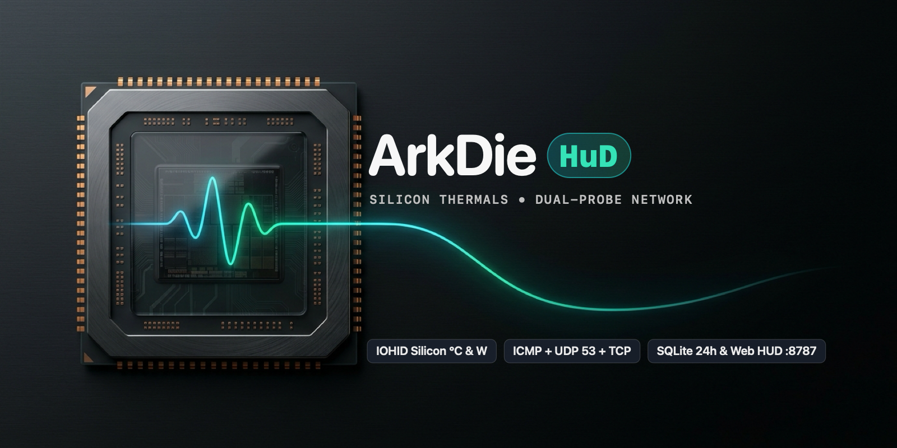
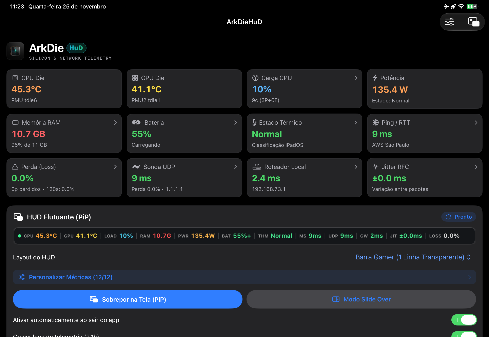
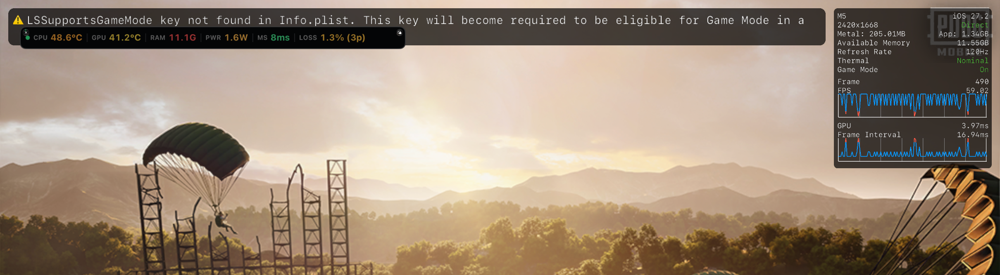
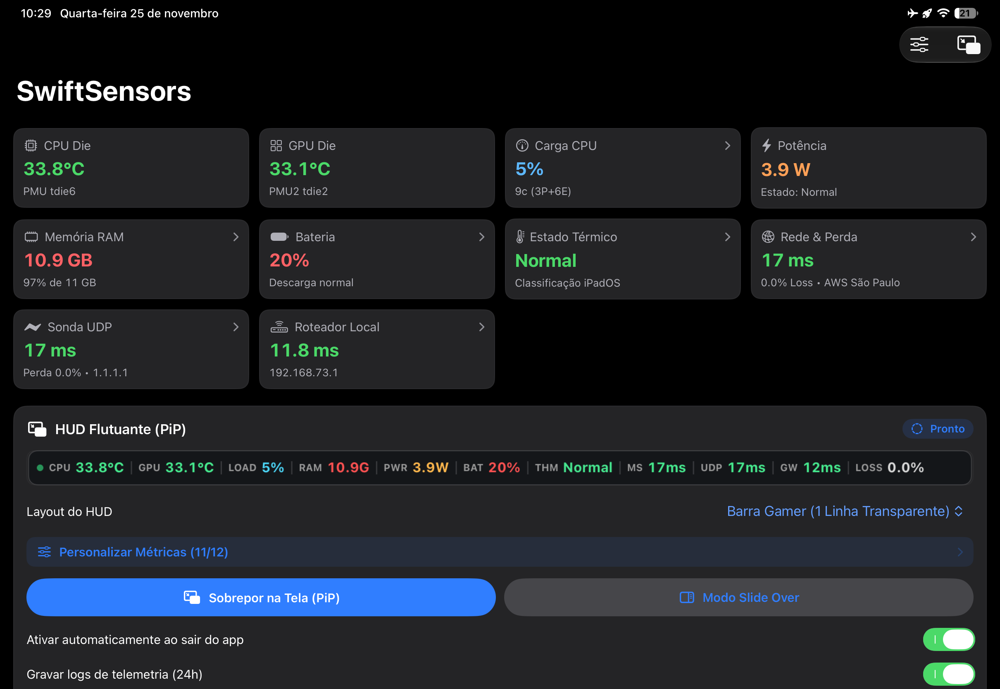
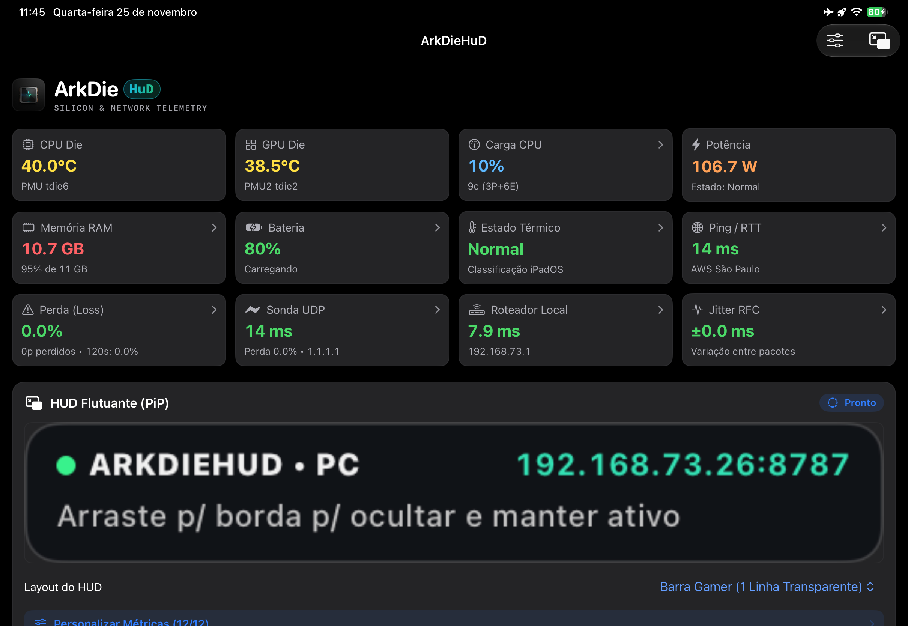

<p align="center">
  
</p>

<p align="center">
  <strong>English</strong> | <a href="README.pt-BR.md">Português (BR)</a> | <a href="README.es.md">Español</a>
</p>

# ArkDieHuD

[](https://swift.org/platforms/)
[](https://swift.org)
[](docs/TUTORIAL.md)
[](LICENSE)

**ArkDieHuD** is a real-time **Apple Silicon** hardware telemetry suite, Picture-in-Picture (`PiP`) overlay, **Dual-Probe (`ICMP + UDP DNS 53 + TCP`)** network monitor, **24-hour SQLite WAL** logger, and local **PC/Mac Web Dashboard (`:8787`)** for **iPadOS & iOS**, built on top of the `SwiftSensors` (`IOHID` + Darwin `Mach`) engine.

> **New here?** Follow the complete step-by-step **[Tutorial Guide (EN)](docs/TUTORIAL.md)** · **[Tutorial (PT-BR)](docs/TUTORIAL.pt-BR.md)** · **[Tutorial (ES)](docs/TUTORIAL.es.md)**

---

## Key Features

- **Real Silicon & Power Sensors (`IOHID` + `Mach`):** Reads actual CPU die clusters (`PMU tdie`), GPU die (`PMU2 tdie`), voltage/current rails, estimated wattage (`W`), total/per-core CPU load, RAM + Jetsam headroom, and iPadOS thermal state — zero fabricated estimates.
- **Floating PiP HUD + Total Customization:** 4 dynamic layouts (*Gamer Bar*, *Gamer Overlay*, *Compact Grid*, *Detailed*) and **12 independent metric toggles** with 4 one-tap presets. Automatically shrinks/expands without jitter. Also includes an iPadOS **Slide Over** mode.
- **Competitive Dual-Probe Network Monitor:** Native non-privileged `SOCK_DGRAM` **ICMP**, real **UDP (DNS port 53)** queries, and **TCP** running side-by-side against your **Local Router (Gateway)** to separate local Wi-Fi issues from ISP/CGNAT drops, complete with `P50/P95/P99`, RFC 3550 jitter, drop-cycle detection, and a 1-hour chronological incident log.
- **24-Hour Persistent SQLite WAL History:** Batched 15-second disk writes with automatic 24-hour pruning, aggregated charts (`15m | 1h | 6h | 24h`), and unified Hardware + Network CSV export.
- **PC/Mac Web Monitor Without On-Screen HUD (`:8787`):** Offline dark web dashboard served straight from the iPad over Wi-Fi or USB (`iproxy 8787 8787`), plus a **Stealth PiP** pill (`Drag to edge to hide & stay active`) to keep background telemetry alive even during full-screen voice-chat games.
- **Automatic 3-Language Support (`en` / `pt-BR` / `es`):** Native iPadOS String Catalog detection across the app, PiP overlay, system permissions, and the PC web dashboard (with quick `EN | PT | ES` switcher).
- **Free Apple ID Ready:** Clean entitlements compatible with free Personal Team signing in Xcode or sideloading tools using the pre-built `ArkDieHuD-unsigned.ipa` in [Releases](https://github.com/Despensativo/ArkDieHuD/releases).

---

## Live Screenshots

<table>
  <tr>
    <td width="50%">
      
      <p align="center"><em>Main Dashboard + Live Telemetry Strip & PiP Preview</em></p>
    </td>
    <td width="50%">
      
      <p align="center"><em>Floating Gamer Bar PiP + Apple Metal FPS HUD over PUBG</em></p>
    </td>
  </tr>
  <tr>
    <td width="50%">
      
      <p align="center"><em>24-Hour Persistent SQLite WAL Charts & CSV Export</em></p>
    </td>
    <td width="50%">
      
      <p align="center"><em>Stealth PC Monitor Pill (:8787) — Drag to edge to hide</em></p>
    </td>
  </tr>
</table>

---

## How to Install — Choose the Best Method for You

| Method | Who is it for? | Requires Xcode / Mac? | How it works |
| :--- | :--- | :--- | :--- |
| **1. Sideloadly + `.ipa`** *(Recommended)* | **Easiest & simplest** (Windows or Mac, no coding) | **No** | Download [`ArkDieHuD-unsigned.ipa`](https://github.com/Despensativo/ArkDieHuD/releases/latest/download/ArkDieHuD-unsigned.ipa) and drag into [Sideloadly](https://sideloadly.io/) with any **free Apple ID**. |
| **2. SideStore / AltStore Classic** | **Auto-updates & auto-refresh** on iPad | **No** *(after setup)* | Add this repo's source URL inside SideStore/AltStore Classic and tap **GET**. |
| **3. Guided Mac Wizard** | **Mac users with Xcode** | **Yes** | Run `./install.sh` — auto-detects your iPad, Apple ID signing team, compiles, and opens the app. |

### Option 1 — Easiest & Simplest — Recommended (Windows or Mac, No Xcode)
1. Download [`ArkDieHuD-unsigned.ipa`](https://github.com/Despensativo/ArkDieHuD/releases/latest/download/ArkDieHuD-unsigned.ipa) from **Releases**.
2. Open **Sideloadly**, connect your iPad, enter your **free Apple ID**, and drop the `.ipa` to install.
3. On your iPad: enable **Settings → Privacy & Security → Developer Mode**, and trust your Apple ID under **Settings → General → VPN & Device Management**.

### Option 2 — SideStore / AltStore Classic Official Source (1-Tap Updates)
Paste this Source URL inside **SideStore** or **AltStore Classic** (*Sources → +*):
```text
https://raw.githubusercontent.com/Despensativo/ArkDieHuD/main/altstore-source.json
```

> **Important (Brazil, EU & Japan):** On [altstore.io](https://altstore.io/), use **AltStore Classic** (via AltServer) or **SideStore** — **not AltStore PAL**. AltStore PAL only installs Apple-notarized marketplace packages (ADP) and cannot install unsigned `.ipa` files or apps using private `IOHID` die thermal sensors / private PiP controls.

### Option 3 — Mac Guided Installer (`./install.sh`) & Optional Tools
```bash
# 1) Clone and run the guided 1-command installer (detects iPad & free/paid Apple ID)
git clone https://github.com/Despensativo/ArkDieHuD.git
cd ArkDieHuD
./install.sh

# 2) Optional: Rebuild unsigned .ipa locally
./Scripts/export-ipa.sh

# 3) Optional: Launch ANY game/app on your iPad with Apple Metal FPS HUD
./launch_metal_hud.sh                         # Interactive menu (all installed apps)
./launch_metal_hud.sh <app_name>              # Search by name (e.g. genshin, cod, pubg, capcut)
./launch_metal_hud.sh --list                  # List all installed apps & Bundle IDs
./launch_metal_hud.sh --bundle <bundle.id>    # Launch directly by Bundle ID
# Tip: Add permanent shortcuts in `CUSTOM_SHORTCUTS` inside `launch_metal_hud.sh` (or ask your AI assistant).

# 4) Optional: USB tunnel for PC/Mac Web Dashboard (http://127.0.0.1:8787)
iproxy 8787 8787
```

> **Free Apple ID vs Paid Account & Why It Is Not on the App Store:**
> - A **free Apple ID** works 100% (valid for **7 days**; SideStore/AltStore Classic auto-refreshes, or re-run `./install.sh` / Sideloadly). A paid Apple Developer account lasts **1 year**.
> - Real Apple Silicon die temperatures and wattage use private `IOHID` APIs, which Apple does not allow on the App Store and cannot be pre-signed for third-party devices.

---

## Documentation

| Guide / Script | Purpose | Link |
| :--- | :--- | :--- |
| **Step-by-Step Tutorial** | Installation (Free Apple ID), PiP, Dual-Probe, 24h Logs, PC Monitor & Metal HUD | [EN](docs/TUTORIAL.md) · [PT-BR](docs/TUTORIAL.pt-BR.md) · [ES](docs/TUTORIAL.es.md) |
| **Apple Metal HUD Guide** | Pairing & launching games with `MTL_HUD_ENABLED=1` | [docs/METAL_HUD_GUIDE.md](docs/METAL_HUD_GUIDE.md) |
| **Architecture Map** | SwiftUI, PiP CoreGraphics, `SwiftSensors`, `IOKit` & SQLite layers | [docs/ARCHITECTURE_MAP.md](docs/ARCHITECTURE_MAP.md) |
| **Brand & Design System** | Silicon Die icon, typography & semantic telemetry tokens | [DESIGN.md](DESIGN.md) |
| **IPA Exporter Script** | Compiles Release and builds `dist/ArkDieHuD-unsigned.ipa` | [Scripts/export-ipa.sh](Scripts/export-ipa.sh) |

---

## Using the `SwiftSensors` Swift Package

You can also import the underlying `SwiftSensors` SPM library in your own Swift/iOS projects:

```swift
dependencies: [
    .package(url: "https://github.com/Despensativo/ArkDieHuD.git", branch: "main")
]
```

```swift
import SwiftSensors

let sensors = SwiftSensors.shared
let thermals = await sensors.getThermalSensorReadings()
let net = await sensors.getNetworkQualityMetrics()
```

---

## ☕ Support Development

If **ArkDieHuD** saved you time or helped you benchmark your device and diagnose network drops, consider supporting development. Any contribution helps fund ongoing Apple Silicon research, hardware testing, and new open-source tools!

<p align="left">
  <a href="https://www.buymeacoffee.com/despensativo" target="_blank">
    
  </a>
</p>

<details>
  <summary>🇧🇷 <b>Support via Pix (Brazil) — QR Code &amp; Copy/Paste</b></summary>
  <br>

  <p align="left">
    
  </p>

  **Pix Copia e Cola:**
```text
00020101021126580014br.gov.bcb.pix01368e4ae808-3a54-4b91-bd4a-0e4249cd37875204000053039865802BR5917HEDSON C DA SILVA6013APARECIDA DE 62070503***6304BE1E
```

  > **Recipient / Titular:** Hedson C da Silva  
  > **Random Key / Chave Aleatória:** `8e4ae808-3a54-4b91-bd4a-0e4249cd3787`

</details>

---

## Note on Private APIs & Attribution

- This project accesses `IOKit` / `IOHID` private APIs for real internal hardware sensors. It is intended for local diagnostics, benchmarking, and personal sideloaded builds via Developer Mode (not App Store distribution).
- Core sensor bindings originally forked from [`trymirai/swift-sensors`](https://github.com/trymirai/swift-sensors) under the MIT License. See [LICENSE](LICENSE).
