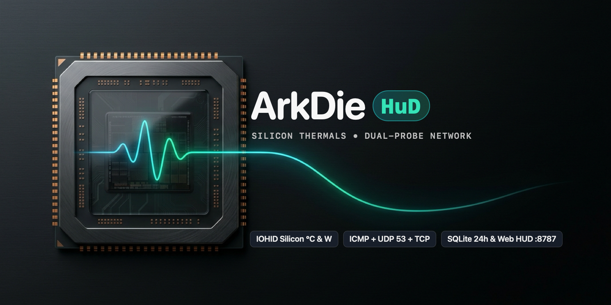
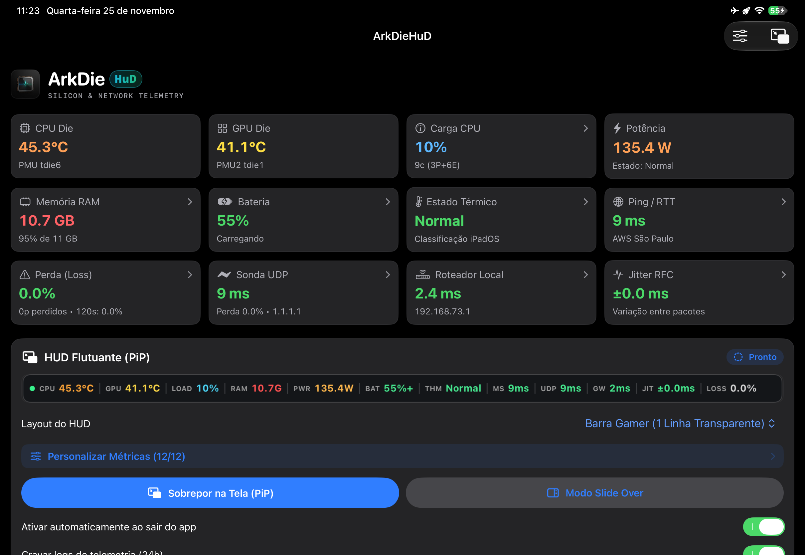
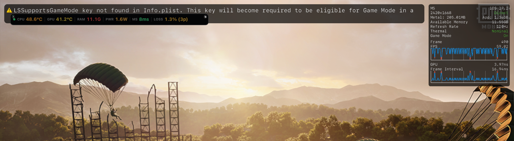
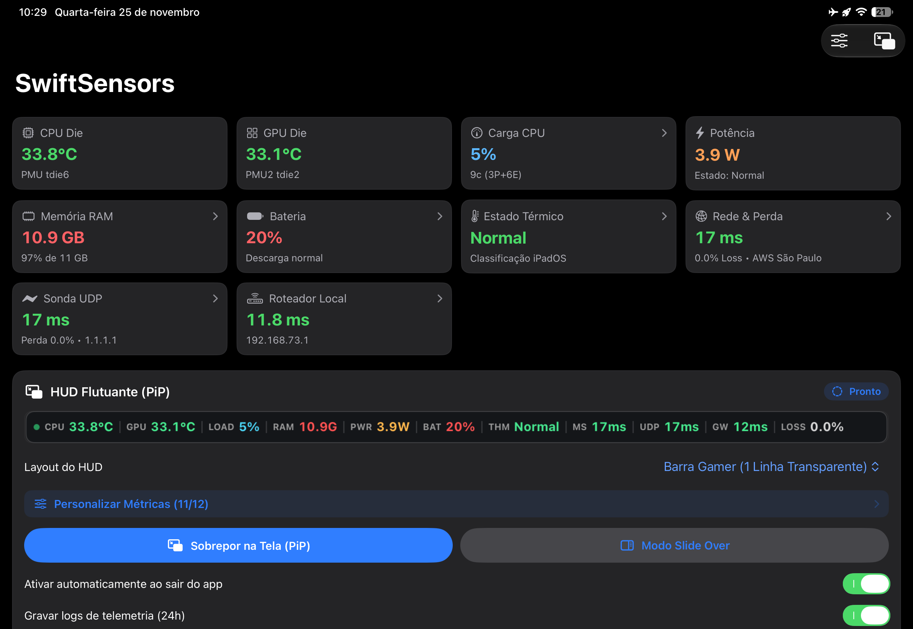
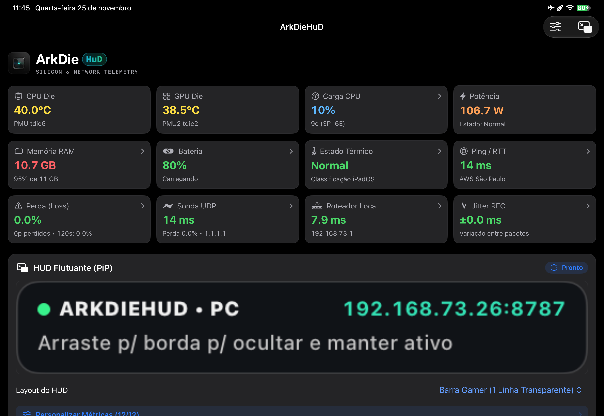

<p align="center">
  
</p>

<p align="center">
  <a href="README.md">English</a> | <strong>Português (BR)</strong> | <a href="README.es.md">Español</a>
</p>

# ArkDieHuD

[](https://swift.org/platforms/)
[](https://swift.org)
[](docs/TUTORIAL.pt-BR.md)
[](LICENSE)

**ArkDieHuD** é uma suíte completa de telemetria física em tempo real para **Apple Silicon (iPadOS & iOS)** construída sobre o motor `SwiftSensors` (`IOHID` + kernel `Mach`), com HUD flutuante Picture-in-Picture (`PiP`), gaveta **Slide Over**, Sonda Dupla Multi-Protocolo (**`ICMP + UDP DNS 53 + TCP`**), gravação contínua de **24h em SQLite WAL** e servidor web local (**`:8787`**) para acompanhar tudo pelo PC ou Mac **sem ocupar a tela do jogo**.

> **Novo por aqui?** Leia o **[Tutorial Passo a Passo Completo (PT-BR)](docs/TUTORIAL.pt-BR.md)** · **[Tutorial (EN)](docs/TUTORIAL.md)** · **[Tutorial (ES)](docs/TUTORIAL.es.md)**

---

## Principais Recursos

- **Sensores Físicos Reais (`IOHID` + `Mach`):** temperatura direta do die da CPU (`PMU tdie`) e GPU (`PMU2 tdie`), trilhos de tensão/corrente, potência estimada (`W`), carga de CPU, RAM + margem Jetsam e estado térmico do iPadOS — zero estimativas inventadas.
- **HUD Flutuante PiP + Personalização Total:** 4 layouts dinâmicos (*Barra Gamer*, *Overlay Gamer*, *Grid Compacto*, *Detalhado*) e **12 toggles independentes** com 4 perfis de 1 toque. Ajusta largura/altura sem tremer e também conta com modo **Slide Over**.
- **Rede Competitiva (Sonda Dupla & Multi-Protocolo):** ping nativo `SOCK_DGRAM` **ICMP**, sonda real **UDP (DNS 53)** e **TCP** rodando em paralelo contra o **Roteador Local (Gateway)** para diferenciar quedas do Wi-Fi de quedas do provedor/CGNAT, com `P50/P95/P99`, Jitter RFC 3550, detector de ciclos e log cronológico de 1 hora.
- **Histórico Persistente 24h (SQLite WAL):** gravação em lote a cada 15s com limpeza automática > 24h, gráficos agregados (`15m | 1h | 6h | 24h`) e exportação CSV unificada (Hardware + Rede).
- **Monitor no PC/Mac Sem PiP na Tela (`:8787`):** painel web offline servido direto do iPad via Wi-Fi ou cabo USB (`iproxy 8787 8787`), além de modo **PiP Discreto** (*Arraste p/ borda p/ ocultar e manter ativo*) para manter a coleta ativa mesmo em jogos com chat de voz.
- **Suporte Automático a 3 Idiomas (`pt-BR` / `en` / `es`):** detecção automática pelo idioma do iPadOS em todas as telas, HUD PiP e permissões, e detecção automática no painel web do PC (com seletor rápido `EN | PT | ES`).
- **Pronto para Apple ID Gratuito:** entitlements limpos para Personal Team no Xcode ou sideload via `ArkDieHuD-unsigned.ipa` na aba [Releases](https://github.com/Despensativo/ArkDieHuD/releases).

---

## Screenshots Reais no iPad

<table>
  <tr>
    <td width="50%">
      
      <p align="center"><em>Painel Principal + Faixa Ao Vivo e Preview PiP</em></p>
    </td>
    <td width="50%">
      
      <p align="center"><em>Barra Gamer PiP + Apple Metal FPS HUD rodando sobre PUBG</em></p>
    </td>
  </tr>
  <tr>
    <td width="50%">
      
      <p align="center"><em>Gráficos Persistentes 24h (SQLite WAL) e Exportação CSV</em></p>
    </td>
    <td width="50%">
      
      <p align="center"><em>Pílula Stealth do Monitor PC (:8787) — Arraste para a borda</em></p>
    </td>
  </tr>
</table>

---

## Como Instalar — Escolha a Melhor Forma Para Você

| Método | Para quem é? | Precisa de Mac / Xcode? | Como funciona |
| :--- | :--- | :--- | :--- |
| **1. Sideloadly + `.ipa`** *(Recomendado)* | **Mais fácil e simples** (Windows ou Mac, zero terminal) | **Não** | Baixe [`ArkDieHuD-unsigned.ipa`](https://github.com/Despensativo/ArkDieHuD/releases/latest/download/ArkDieHuD-unsigned.ipa) e arraste no [Sideloadly](https://sideloadly.io/) com seu **Apple ID gratuito**. |
| **2. SideStore / AltStore Classic** | **Atualizações e renovação automáticas** no iPad | **Não** *(após configurar)* | Adicione o catálogo oficial abaixo dentro do SideStore/AltStore Classic e toque em **GET**. |
| **3. Assistente no Mac** | **Quem usa Mac com Xcode** | **Sim** | Rode `./install.sh` — detecta iPad e Apple ID sozinho, compila, instala e abre o app. |

### Opção 1 — Mais Fácil e Simples — Recomendado (Windows ou Mac, Sem Xcode)
1. Baixe o arquivo pronto [`ArkDieHuD-unsigned.ipa`](https://github.com/Despensativo/ArkDieHuD/releases/latest/download/ArkDieHuD-unsigned.ipa).
2. Abra o **Sideloadly**, conecte o iPad, informe qualquer **Apple ID gratuito** e arraste o `.ipa` para instalar.
3. No iPad: ative **Ajustes → Privacidade e Segurança → Modo Desenvolvedor** e confie no perfil em **Ajustes → Geral → Gestão de VPN e Dispositivo**.

### Opção 2 — Catálogo Oficial SideStore / AltStore Classic (1 Toque)
Cole esta URL dentro de **SideStore** ou **AltStore Classic** (*Sources → +*):
```text
https://raw.githubusercontent.com/Despensativo/ArkDieHuD/main/altstore-source.json
```

> **Importante (Brasil, UE e Japão):** No site [altstore.io](https://altstore.io/), baixe o **AltStore Classic** (via AltServer) ou use o **SideStore** — **não use o AltStore PAL**. O AltStore PAL aceita apenas pacotes notarizados pela Apple (ADP) e bloqueia arquivos `.ipa` comuns e APIs privadas (`IOHID` de temperatura do silício e controles internos do PiP).

### Opção 3 — Assistente Guiado no Mac (`./install.sh`) e Extras
```bash
# 1) Clonar e rodar o instalador automático (detecta iPad, certificado/Apple ID e instala)
git clone https://github.com/Despensativo/ArkDieHuD.git
cd ArkDieHuD
./install.sh

# 2) Opcional: Gerar o .ipa sem assinatura localmente
./Scripts/export-ipa.sh

# 3) Opcional: Abrir QUALQUER jogo ou app no iPad com Apple Metal FPS HUD
./launch_metal_hud.sh                         # Menu interativo (todos os apps instalados)
./launch_metal_hud.sh <nome_do_app>           # Busca por nome (ex: genshin, cod, pubg, capcut)
./launch_metal_hud.sh --list                  # Lista todos os apps e seus Bundle IDs
./launch_metal_hud.sh --bundle <bundle.id>    # Inicia direto pelo Bundle ID exato
# Dica: salve atalhos fixos em `CUSTOM_SHORTCUTS` dentro de `launch_metal_hud.sh` (ou peça para sua IA ajustar).

# 4) Opcional: Túnel USB para ver o painel do PC em http://127.0.0.1:8787
iproxy 8787 8787
```

> **Apple ID Gratuito vs Conta Paga e Por Que Não Vem Pré-Assinado:**
> - **Conta Apple gratuita** funciona 100% (vale por **7 dias**; no SideStore/AltStore Classic renova sozinho, ou basta rodar `./install.sh` / Sideloadly de novo). Conta paga dura **1 ano**.
> - Leituras reais do die CPU/GPU e Watts usam APIs privadas (`IOHID`), que a Apple bloqueia na App Store e não permite pré-assinar para aparelhos de terceiros.

---

## Documentação e Guias

| Guia / Script | Finalidade | Link |
| :--- | :--- | :--- |
| **Tutorial Passo a Passo** | Instalação gratuita, PiP, Sonda Dupla, Logs 24h, Monitor PC e Metal HUD | [PT-BR](docs/TUTORIAL.pt-BR.md) · [EN](docs/TUTORIAL.md) · [ES](docs/TUTORIAL.es.md) |
| **Guia Apple Metal HUD** | Como parear e abrir jogos com `MTL_HUD_ENABLED=1` | [docs/METAL_HUD_GUIDE.md](docs/METAL_HUD_GUIDE.md) |
| **Mapa de Arquitetura** | Camadas SwiftUI, PiP CoreGraphics, `SwiftSensors`, `IOKit` e SQLite | [docs/ARCHITECTURE_MAP.md](docs/ARCHITECTURE_MAP.md) |
| **Identidade Visual** | Ícone Silicon Die, tipografia e paleta oficial | [DESIGN.md](DESIGN.md) |
| **Gerador de `.ipa`** | Compila `Release` e empacota `dist/ArkDieHuD-unsigned.ipa` | [Scripts/export-ipa.sh](Scripts/export-ipa.sh) |

---

## ☕ Apoie o Desenvolvimento

Se o **ArkDieHuD** te economizou tempo ou te ajudou a diagnosticar hardware e quedas de rede no seu iPad, sinta-se à vontade para apoiar o desenvolvimento. Qualquer valor incentiva novas pesquisas em Apple Silicon, testes e ferramentas abertas!

<p align="left">
  <a href="https://www.buymeacoffee.com/despensativo" target="_blank">
    
  </a>
</p>

<details>
  <summary>🇧🇷 <b>Apoiar via Pix (Brasil) — QR Code &amp; Copia e Cola</b></summary>
  <br>

  <p align="left">
    
  </p>

  **Pix Copia e Cola:**
```text
00020101021126580014br.gov.bcb.pix01368e4ae808-3a54-4b91-bd4a-0e4249cd37875204000053039865802BR5917HEDSON C DA SILVA6013APARECIDA DE 62070503***6304BE1E
```

  > **Titular:** Hedson C da Silva  
  > **Chave Aleatória:** `8e4ae808-3a54-4b91-bd4a-0e4249cd3787`

</details>

---

## Nota sobre APIs Privadas e Créditos

- Este projeto utiliza APIs privadas `IOKit` / `IOHID` para acessar sensores internos reais do hardware. Destina-se a diagnóstico local, benchmarking e builds pessoais em Modo Desenvolvedor (não para App Store).
- Bindings base originalmente derivados de [`trymirai/swift-sensors`](https://github.com/trymirai/swift-sensors) sob licença MIT. Consulte [LICENSE](LICENSE).
