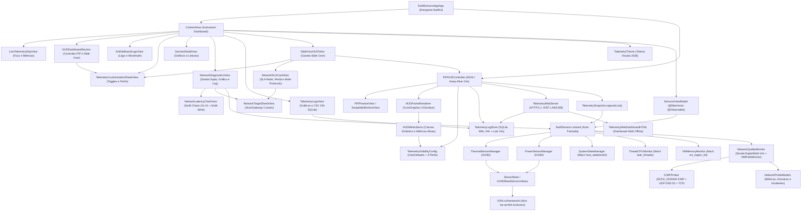

# Mapa de Arquitetura — `swift-sensors` & `SwiftSensorsApp`

> **Última atualização:** 2026-11-24 | **Alvo:** iPadOS / iOS (`ios-arm64`)

## 1. Visão Geral em Camadas

O repositório é composto por um pacote **Swift Package Manager (`SwiftSensors`)**, uma camada Objective-C/C segura para leitura IOHID (`PrivateAPI` + `IOKit.xcframework`) e um aplicativo consumidor em **SwiftUI + UIKit/AVKit/CoreGraphics (`SwiftSensorsApp`)** estruturado segundo o guia visual [DESIGN.md](../DESIGN.md).

---

## 2. Estrutura de Diretórios e Módulos Críticos

| Caminho | Camada | Responsabilidade |
| :--- | :--- | :--- |
| `Package.swift` | Manifest SPM | Define `SwiftSensors` (Swift tools 6.0, `.iOS(.v16)`), `PrivateAPI` e `binaryTarget` `IOKit`. |
| `Frameworks/IOKit.xcframework` | Binário Apple | Stub/wrapper do framework `IOKit` contendo **exclusivamente** a arquitetura `ios-arm64`. |
| `Sources/PrivateAPI/` | Ponte Obj-C / C | `PrivateAPI.h` e `PrivateAPI.m`: função `IOHIDReadSensorValues` em passagem única com `CFRelease` em todos os objetos CoreFoundation. |
| `Sources/SwiftSensors/SwiftSensors.swift` | Biblioteca (Fachada) | Actor `SwiftSensors.shared` centralizando sensores térmicos, energia, CPU, RAM, disco, threads, VM, histórico/log de rede e exportação CSV. |
| `Sources/SwiftSensors/SensorBase.swift` | Biblioteca (IOHID) | Protocolos `BaseSensorReading`/`SensorManager` e `SensorUtils.readValues(...)` sobre `IOHIDReadSensorValues`. |
| `Sources/SwiftSensors/ThermalSensors.swift` | Biblioteca (Térmico) | Actor `ThermalSensorManager` lendo página `0xff00` / uso `0x0005` com `id` estável pelo nome do sensor. |
| `Sources/SwiftSensors/PowerSensors.swift` | Biblioteca (Energia) | Actor `PowerSensorManager` lendo página `0xff08` / usos `0x0003` (tensão) e `0x0002` (corrente). |
| `Sources/SwiftSensors/SystemStats.swift` | Biblioteca (Sistema) | Actor `SystemStatsManager`: `host_statistics64` (RAM), deltas de CPU, disco, estado térmico, bateria e uptime. |
| `Sources/SwiftSensors/ThreadCPUMonitor.swift` | Biblioteca (Kernel) | Actor `ThreadCPUMonitor`: profiling via `task_threads` / `thread_info` liberando Mach send rights anteriores com `mach_port_deallocate`. |
| `Sources/SwiftSensors/VMMemoryMonitor.swift` | Biblioteca (Memória) | Actor `VMMemoryMonitor`: `task_vm_info`, risco Jetsam, handlers de purge e scanner seguro `vm_region_64`. |
| `Sources/SwiftSensors/NetworkProbeModels.swift` | Modelos de Rede | Define `NetworkProbeTarget`, `NetworkProbeProtocol`, `NetworkRouteInfo`, `NetworkProbeSample`, `NetworkIncidentEvent` e `NetworkQualityMetrics`. |
| `Sources/SwiftSensors/ICMPProber.swift` | Motor de Rede BSD | Sondas não-privilegiadas ICMP (`SOCK_DGRAM` + `IPPROTO_ICMP`) e UDP DNS (`SOCK_DGRAM` porta 53), fallback TCP (`NWConnection`), cache DNS IPv4 e detecção de gateway/VPN via `getifaddrs`. |
| `Sources/SwiftSensors/NetworkQualityMonitor.swift` | Biblioteca (Rede) | Actor `NetworkQualityMonitor`: sonda dupla e multi-protocolo simultânea (`ICMP + UDP + TCP` vs Gateway), `NWPathMonitor`, percentis `P50/P95/P99`, rajadas, spikes, ciclo (~93s), log anti-flood de incidentes (1000 eventos), histórico 1 hora (3600 amostras) e exportação CSV. |
| `Examples/SwiftSensorsApp/Theme/TelemetryTheme.swift` | Design System | Tokens semânticos (Light/Dark), constantes de layout, alvos mínimos e cores semânticas de telemetria. |
| `Examples/SwiftSensorsApp/Models/TelemetrySnapshot.swift` | Modelo de Snapshot | Consolida telemetria concorrente, mapeia sensores Apple Silicon (`PMU tdie` CPU / `PMU2 tdie` GPU), calcula Watts e lê `HardwareTopology`. |
| `Examples/SwiftSensorsApp/Models/TelemetryVisibilityConfig.swift` | Configuração de UI | Toggles persistidos (`UserDefaults`) para métricas individuais, seções do Painel/Slide Over e 4 perfis rápidos (`Gamer`, `Rede Competitiva`, `Ultra Minimal`, `Mostrar Tudo`). |
| `Examples/SwiftSensorsApp/HUD/` | Subsistema PiP | `HUDLayoutMode` (4 modos), `HUDMetricItems` (slots e canvas dinâmico sem espaços vazios), `HUDFrameRenderer` (IOSurface BGRA 2x), `PiPHUDController` (AVKit + áudio silencioso + `#if DEBUG Logger`), `PiPPreviewView`. |
| `Examples/SwiftSensorsApp/Views/Screens/` | Telas do App | `ContentView`, `NetworkDiagnosticsView`, `TelemetryLogsView`, `SectionDetailView`, `SlideOverHUDView`, `SensorDetailView`, `SensorChartView`. |
| `Examples/SwiftSensorsApp/Stores/` | Persistência & Web | `SensorReadingsStore` (cache por sensor), `TelemetryLogStore` (SQLite WAL 24h, lote 15s, CSV em streaming), `TelemetryWebServer` (HTTP `:8787` sem PiP) e `TelemetryWebDashboardHTML` (painel web offline). |
| `Examples/SwiftSensorsApp/ViewModels/SensorsViewModel.swift` | ViewModel Principal | `@MainActor @Observable`, fetch concorrente indexado, purge real de caches/histórico e estado de gráficos. |
| `Examples/SwiftSensorsApp/Views/Components/` | UI Modular | `ArkDieBrandLogoView`, `LiveTelemetryStripView`, `TelemetryCustomizationSheetView`, `NetworkSLACardView`, `NetworkLatencyChartView`, `NetworkTargetSheetView`, `HUDDashboardSection`, `PerformanceSectionView`, `MultiSensorChart`, `StatCharts`. |
| `Media/` | Marca e GitHub | `arkdiehud_icon.png` (`512×512`) e `arkdiehud_github_banner.png` (`1600×800` para README/GitHub). |
| `launch_metal_hud.sh` | Utilitário Host Mac | Script Python sem UDID hardcoded que auto-detecta o iPad pareado via `xcrun devicectl`, lista apps e inicia jogos com Apple Metal HUD (`MTL_HUD_ENABLED=1`). Guia completo em [METAL_HUD_GUIDE.md](METAL_HUD_GUIDE.md). |

---

## 3. Inventário de Arquivos Acima de 300 Linhas

Qualquer edição nos arquivos abaixo exige Mini-Plano de Impacto prévio (`.agents/rules/20-spec-driven-impact.md`):

| Arquivo | Linhas | Concentração Atual |
| :--- | :---: | :--- |
| `Sources/SwiftSensors/NetworkQualityMonitor.swift` | 949 | Actor completo de sonda dupla/multi-protocolo (`ICMP+UDP+TCP`), persistência, incidentes anti-flood, percentis em cache, histórico 1h (3600s) e exportação CSV. |
| `Examples/SwiftSensorsApp/HUD/HUDFrameRenderer.swift` | 597 | 4 layouts CoreGraphics dinâmicos + modo PiP discreto (`Arraste p/ borda`) + criação de `CVPixelBuffer`/`CMSampleBuffer`. |
| `Examples/SwiftSensorsApp/Views/Screens/NetworkDiagnosticsView.swift` | 594 | Painel sonda dupla + comparativo ICMP/UDP/TCP, SLA competitivo, gráfico embutido, log cronológico com confirmação de reset e `ShareLink` CSV sob demanda. |
| `Examples/SwiftSensorsApp/HUD/PiPHUDController.swift` | 582 | Timebase CMClock, `AVPictureInPictureController`, Zero-Render em background, Auto-Heal de áudio, `visibilityConfig`, `isRecordingLogs` e servidor web `:8787`. |
| `Examples/SwiftSensorsApp/HUD/HUDMetricItems.swift` | 555 | Builder dinâmico de itens inline/cards/linhas e cálculo determinístico de tamanho do canvas PiP conforme `TelemetryVisibilityConfig` e modo PC discreto. |
| `Examples/SwiftSensorsApp/Stores/TelemetryLogStore.swift` | 485 | Actor SQLite WAL gravando 1Hz em lotes de 15s com retenção automática de 24h, consulta agregada e CSV em streaming. |
| `Examples/SwiftSensorsApp/Views/Screens/TelemetryLogsView.swift` | 452 | Visualizador 24h ao vivo (Térmico / Energia & RAM / Rede) em `15m/1h/6h/24h`, toggle de gravação, tamanho em disco e CSV unificado. |
| `Sources/SwiftSensors/NetworkProbeModels.swift` | 444 | DTOs públicos (`Sendable`/`Codable`) de métricas, protocolos (`Multi/Auto/ICMP/UDP/TCP`), rota/VPN, amostras e incidentes de rede. |
| `Examples/SwiftSensorsApp/Views/Screens/SlideOverHUDView.swift` | 429 | Gaveta Slide Over modular controlada por `TelemetryVisibilityConfig` (cards e métricas individuais personalizáveis). |
| `Sources/SwiftSensors/ICMPProber.swift` | 413 | Probes datagrama BSD (`IPPROTO_ICMP` + UDP DNS porta 53), TCP `NWConnection`, DNS cache e inspeção `getifaddrs`. |
| `Examples/SwiftSensorsApp/Views/Components/NetworkSLACardView.swift` | 399 | Card compacto de Rede & SLA + confirmação de reset + seletor de alvo/modo + barra compacta ICMP/UDP/TCP e VPN. |
| `Examples/SwiftSensorsApp/ViewModels/SensorsViewModel.swift` | 390 | `@MainActor @Observable`, fetch ordenado por índice e séries históricas de gráficos. |
| `Examples/SwiftSensorsApp/Models/TelemetrySnapshot.swift` | 390 | `HardwareTopology`, captura concorrente `async let` e heurística de sensores CPU/GPU/Watts. |
| `Examples/SwiftSensorsApp/Stores/TelemetryWebDashboardHTML.swift` | 377 | Dashboard web offline autocontido (`HTML/CSS/JS`) com logo SVG, KPIs 1s, gráficos Canvas e timeline de incidentes. |
| `Examples/SwiftSensorsApp/Views/Components/NetworkLatencyChartView.swift` | 328 | Gráfico Swift Charts 2m/5m/15m/30m/1h com downsampling preservador de picos, multi-série e marcadores de drop. |
| `Sources/SwiftSensors/SystemStats.swift` | 316 | Estatísticas Mach VM, CPU deltas, disco, bateria e `ThermalState`. |
| `Examples/SwiftSensorsApp/Views/Components/LiveTelemetryStripView.swift` | 301 | Faixa ao vivo no topo do painel construída dinamicamente conforme as métricas ativas em `TelemetryVisibilityConfig`. |

---

## 4. Fluxos de Dados em Tempo Real e Invariantes

1. **Loop de HUD PiP (1 Hz):** `PiPHUDController` → `TelemetrySnapshot.captureLive()` (`async let` na fachada `SwiftSensors.shared`) → `HUDFrameRenderer` (`CVPixelBuffer` IOSurface BGRA 2x) → `AVSampleBufferDisplayLayer`.
2. **Loop Sonda Dupla & Multi-Protocolo (1 Hz):** `NetworkQualityMonitor` lê bytes/interfaces (`getifaddrs`) + `NWPathMonitor` → dispara em paralelo `ICMPProber` para **Roteador Local** e **Alvo Externo** (padrão `1.1.1.1` ou customizado, modo `Simultâneo` rodando ICMP + UDP DNS 53 + TCP em paralelo, ou modos individuais/`Auto`) → classifica causa (`ispDrop` vs `localDrop` vs `protocolDrop`), registra até 1000 incidentes, recalcula `P50/P95/P99` e retém 3600 amostras (1h).
3. **Invariantes Preservados:** compilação `generic/platform=iOS` (`IOKit.xcframework` arm64-only), `controlsStyle = 1` + `.positiveInfinity` no PiP, sensores `PMU tdie*`/`PMU2 tdie*`, zero FPS falso via `CADisplayLink`.
